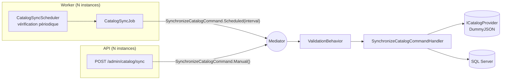
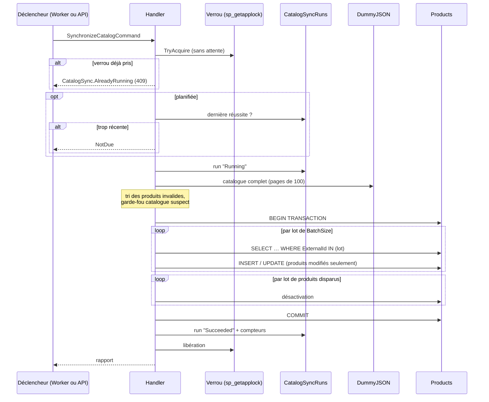

# Synchronisation du catalogue

Ce document décrit la synchronisation du catalogue DummyJSON vers la base locale : son fonctionnement, les garanties qu'elle apporte en multi-instance, sa configuration et ses limites. La version courte se trouve dans [`DECISIONS.md`](../DECISIONS.md) §5.

Voir aussi : [`verrou-distribue.md`](verrou-distribue.md) (fiche détaillée sur `sp_getapplock`, avec sources) et [`tests-manuels-synchronisation.md`](tests-manuels-synchronisation.md) (mode opératoire de test manuel).

## 1. En bref

| Exigence de l'énoncé | Réponse |
|---|---|
| Récupérer l'ensemble des produits et les conserver localement | Récupération paginée complète (`DummyJsonCatalogProvider`), puis écriture en base par lots |
| Synchronisation automatique quotidienne | Planification du Worker, **partagée entre instances** et stockée en base (§5) |
| Déclenchement manuel | `POST /admin/catalog/sync`, qui envoie **la même commande** que le Worker |
| Ajouter et actualiser sans doublon | Index unique sur `Products.ExternalId` ; recherche par identifiant fournisseur avant écriture |
| Incident fournisseur sans effet sur la consultation | Aucune écriture tant que le catalogue n'est pas entièrement récupéré et vérifié ; lectures non bloquées (RCSI, §6) |
| Échec ou interruption : données cohérentes, reprise possible | Une seule transaction ; un échec annule tout ; l'exécution suivante repart de zéro |
| Produits disparus chez le fournisseur | Désactivés, jamais supprimés : ils restent lisibles dans les paniers, mais on ne peut plus les ajouter |
| Exécutions simultanées ou répétées, multi-instance | Verrou distribué `sp_getapplock` sur toute l'exécution ; échéance vérifiée sous ce verrou |

## 2. Deux points d'entrée, un seul cas d'usage



- **Le traitement vit dans `Application`** (`Catalog/Synchronization`) : `SynchronizeCatalogCommand` et son handler. C'est le seul endroit qui sait synchroniser.
- **Les hôtes ne font que déclencher.** Le Worker envoie la commande selon un planning ; l'endpoint de l'API l'envoie à la demande et attend le résultat. Aucun des deux n'appelle le fournisseur ou la base directement.
- L'API référence `Infrastructure.DummyJson` **uniquement pour la composition** (enregistrement des dépendances) : le handler a besoin d'un `ICatalogProvider`, que l'hôte doit fournir.
- Changer de déclencheur (Quartz, Hangfire, Azure Functions…) revient à écrire un nouvel hôte qui envoie la même commande. Le cas d'usage ne change pas.

La commande porte son déclencheur :

| Fabrique | Déclencheur | Comportement |
|---|---|---|
| `SynchronizeCatalogCommand.Manual()` | `Manual` | S'exécute toujours, sauf si une autre synchronisation est en cours |
| `SynchronizeCatalogCommand.Scheduled(interval)` | `Scheduled` | Ne s'exécute que si la dernière synchronisation **réussie** date de plus de `interval` |

## 3. Déroulement d'une exécution



Si une étape échoue avant le `COMMIT`, la transaction est annulée, le run passe en `Failed` avec sa cause, et le verrou est libéré. Le catalogue reste exactement dans l'état d'avant.

## 4. Exclusivité entre instances : le verrou distribué

### Mécanisme

Fiche complète, limites, questions d'entretien et sources : [`verrou-distribue.md`](verrou-distribue.md).

`SqlServerDistributedLock` (dans `Infrastructure.Persistence`) s'appuie sur `sp_getapplock`, le verrou applicatif natif de SQL Server :

- `@LockMode = 'Exclusive'` : un seul détenteur à la fois, toutes instances confondues ;
- `@LockTimeout = 0` : pas d'attente. Si le verrou est pris, on répond immédiatement `AlreadyRunning` ;
- `@LockOwner = 'Session'` : le verrou appartient à la **connexion** et non à une transaction, ce qui permet de le garder pendant la récupération HTTP sans ouvrir de transaction.

### Pourquoi le verrou couvre aussi la récupération

Un verrou limité à la phase d'écriture laisserait passer ce scénario :

1. l'instance A récupère le catalogue à t0 ;
2. l'instance B récupère le catalogue à t1, plus récent, puis l'écrit ;
3. l'instance A écrit **ensuite** sa version de t0, plus ancienne.

Le verrou est donc pris **avant** l'appel au fournisseur et rendu **après** l'enregistrement du résultat.

### Pourquoi la connexion du DbContext

Le verrou est posé sur la connexion du `BeanStockDbContext` de la requête, celle-là même qui porte la transaction et les écritures. Verrou et transaction appartiennent donc à la **même session** SQL Server.

### Perte du verrou et contrôle avant commit (« fencing »)

Un verrou distribué peut être perdu sans que son détenteur le sache : coupure réseau, basculement de la base, session tuée. SQL Server libère alors le verrou avec la session, et une autre instance peut démarrer. Or EF Core peut **rouvrir** silencieusement une connexion coupée, sur une nouvelle session qui, elle, ne détient pas le verrou. Sans précaution, l'ancien détenteur pourrait encore écrire.

Le handler vérifie donc, **juste avant le commit et à l'intérieur de la transaction**, que la session détient toujours le verrou (`APPLOCK_MODE('public', @resource, 'Session') = 'Exclusive'`, via `IDistributedLockHandle.IsStillHeldAsync`). Sinon, il renonce : rollback, erreur `CatalogSync.LockLost` (`409`), run `Failed`.

Cette vérification est sûre parce que verrou et transaction partagent la session : si la réponse est positive puis que la session meurt avant le commit, le commit échoue avec elle. Une connexion inutilisable est traitée comme un verrou perdu.

C'est l'application, à notre échelle, d'un principe général : **aucun verrou distribué ne suffit seul**. C'est l'écriture elle-même qui doit vérifier qu'on a toujours le droit d'écrire (dans la littérature, on parle de *fencing token*).

### Ce que le verrou ne fait pas

`sp_getapplock` ne verrouille **aucune donnée** : il réserve un **nom**. Seul un appelant qui demande le même nom attend ou échoue. Les paniers, les lectures et toute autre écriture ne sont pas concernés. Le verrou est **coopératif** : un `UPDATE Products` lancé hors de l'application ne le voit pas. C'est acceptable parce que seule la synchronisation écrit dans `Products`.

Les verrous sur les données, eux, viennent de la transaction de synchronisation : verrous de lignes posés par ses `INSERT`/`UPDATE`, qui peuvent être regroupés en un verrou sur toute la table au-delà d'environ 5 000 (escalade de verrous). Voir les conséquences en §12.

### Observer le verrou

```sql
-- Verrous applicatifs actifs (pendant une synchronisation)
SELECT request_session_id, resource_description, request_mode, request_status
FROM sys.dm_tran_locks WHERE resource_type = 'APPLICATION';
```

Pour expérimenter : dans deux fenêtres SSMS, prendre le verrou avec `EXEC sp_getapplock @Resource = 'demo', @LockMode = 'Exclusive', @LockOwner = 'Session';` dans la première, puis le demander avec `@LockTimeout = 0` dans la seconde (résultat `-1`). Fermer la première fenêtre simule un crash : le verrou se libère.

Si un processus plante, SQL Server ferme sa session et libère le verrou : aucun verrou ne peut rester bloqué. Le run correspondant reste en `Running` dans l'historique, sans conséquence (voir §8).

### Alternatives écartées

| Option | Pourquoi pas |
|---|---|
| Ligne « verrou » dans une table, avec date d'expiration | Il faut gérer l'expiration et le renouvellement. Un verrou expiré pendant une longue exécution laisse passer une deuxième instance |
| Redis / RedLock | Un composant d'infrastructure de plus, pour un besoin que la base satisfait déjà |
| Bibliothèque `DistributedLock.SqlServer` (MIT) | Très solide et basée sur le même mécanisme. Écartée pour garder la maîtrise et la lisibilité de quelques lignes de SQL. C'est le remplacement naturel si le besoin de verrous se généralise |

## 5. Planification partagée

### Le problème d'un minuteur par instance

Un `PeriodicTimer(24h)` dans chaque Worker ne convient pas en multi-instance :

- trois instances démarrées à 8h, 11h et 15h produisent **trois synchronisations par jour** ;
- chaque redémarrage (déploiement, crash) **relance une synchronisation** ;
- un Worker arrêté pendant deux jours ne sait pas qu'il a du retard.

Le verrou empêche deux exécutions **simultanées**, mais pas des exécutions **répétées**.

### La solution : une échéance commune, stockée en base

Chaque Worker se réveille toutes les `CheckInterval` (1 minute par défaut) et envoie `SynchronizeCatalogCommand.Scheduled(Interval)`. Le handler, **une fois le verrou obtenu**, lit la date de la dernière synchronisation réussie dans `CatalogSyncRuns` :

- si elle date de moins de `Interval`, il répond `NotDue` sans rien faire ;
- sinon, il synchronise.

Comme la vérification se fait sous le verrou, deux Workers qui se réveillent en même temps ne peuvent pas synchroniser tous les deux : le second obtient soit `AlreadyRunning`, soit, une fois le verrou libéré, `NotDue`, car la réussite du premier est déjà enregistrée.

Exemple avec `Interval` = 24 h et trois Workers :

| Heure | Worker A | Worker B | Worker C | Dernière réussite |
|---|---|---|---|---|
| J 03:00 | synchronise (5 s) | `AlreadyRunning` | — | J 03:00 |
| J 03:01 | `NotDue` | `NotDue` | `NotDue` | J 03:00 |
| J 14:00 | redémarré : `NotDue` | `NotDue` | `NotDue` | J 03:00 |
| J+1 03:00 | `NotDue` | synchronise | `AlreadyRunning` | J+1 03:00 |

Ce qu'on obtient :

- **une synchronisation par période**, quel que soit le nombre d'instances ;
- **aucune synchronisation en trop au redémarrage** ;
- **un rattrapage automatique** : un Worker qui démarre après une longue interruption synchronise tout de suite, car l'échéance est dépassée ;
- **une base de départ vide** (premier démarrage) déclenche une synchronisation immédiate ;
- une synchronisation **manuelle** compte comme une réussite et **décale** donc la suivante. C'est voulu : le catalogue vient d'être rafraîchi.

### Échecs et nouvelle tentative

Après un échec (fournisseur indisponible, catalogue suspect, erreur inattendue), l'échéance reste dépassée puisque seules les réussites comptent. Pour ne pas solliciter un fournisseur en incident toutes les minutes, le Worker attend `RetryDelay` (15 minutes par défaut) avant la vérification suivante. `AlreadyRunning` n'est pas un échec : une autre instance travaille, et la vérification suivante trouvera `NotDue`.

Le planificateur ne s'arrête jamais sur une erreur (base injoignable au démarrage, par exemple) : l'erreur est journalisée et la vérification suivante réessaie.

### Paramètres

Section `CatalogSync:Schedule` du Worker (`CatalogSyncScheduleOptions`). Les durées sont au format `TimeSpan` : `"1.00:00:00"` = 1 jour, `"00:05:00"` = 5 minutes, `"00:00:30"` = 30 secondes.

| Clé | Défaut | Rôle | Limites |
|---|---|---|---|
| `Enabled` | `true` | `false` arrête les synchronisations automatiques ; le déclenchement manuel reste possible | — |
| `Interval` | `1.00:00:00` | Délai minimal entre deux synchronisations réussies, commun à toutes les instances | ≥ 10 s |
| `CheckInterval` | `00:01:00` | Fréquence des vérifications de chaque Worker : borne le retard au démarrage et le temps de prise en compte d'un changement de configuration | 1 s à 1 h |
| `RetryDelay` | `00:15:00` | Attente après un échec avant la vérification suivante (jamais moins que `CheckInterval`) | > 0 |

Les valeurs sont **validées au démarrage** : un Worker mal configuré refuse de démarrer, avec un message explicite.

### Modifier le délai en local

Trois façons, de la plus simple à la plus ponctuelle :

1. **Profil Visual Studio `BeanStock.Worker (synchro rapide)`** : à choisir dans la liste déroulante de démarrage. Il fixe `Interval` = 2 min, `CheckInterval` = 15 s et `RetryDelay` = 30 s par variables d'environnement (`CatalogSync__Schedule__Interval`, etc.).
2. **`src/BeanStock.Worker/appsettings.Development.json`** : la section y est reprise en entier pour savoir où intervenir. **La modification est prise en compte sans redémarrage**, à la vérification suivante. Les profils de lancement fixent le répertoire de travail sur le dossier du projet (`workingDirectory`), c'est donc bien ce fichier qui est surveillé, et non sa copie dans `bin/`.
3. **Variable d'environnement** ou *user secrets* : `CatalogSync__Schedule__Interval=00:05:00`.

Attention à la priorité : une variable d'environnement l'emporte sur `appsettings.Development.json`. Avec le profil « synchro rapide », il faut modifier le profil et non le fichier JSON.

Une valeur invalide saisie pendant l'exécution (par exemple `Interval` = `00:00:01`) est **ignorée** : le Worker journalise une erreur et garde les derniers réglages valides, au lieu de s'arrêter.

Pour **forcer** une synchronisation sans attendre l'échéance, il suffit d'appeler `POST /admin/catalog/sync`.

### Alternatives écartées

| Option | Pourquoi pas (pour l'instant) |
|---|---|
| Heure fixe (« tous les jours à 3h ») | Peu pratique pour les tests manuels. Facile à ajouter : c'est une autre règle de calcul de l'échéance, toujours vérifiée sous le verrou |
| Expression cron (bibliothèque Cronos) | Plus expressive, mais une dépendance de plus pour un besoin quotidien. Même remarque : seule la règle de calcul de l'échéance changerait |
| Quartz.NET en mode cluster | Nécessite son propre schéma de tables et sa configuration. Disproportionné pour une seule tâche |
| Hangfire | Tableau de bord appréciable, mais schéma et stockage dédiés, et une logique de reprise qui doublonnerait la nôtre |
| Déclencheur minuterie Azure Functions | Pertinent en production Azure : le déclencheur garantit déjà une exécution unique via un bail sur un blob. Il enverrait la même commande, et le verrou SQL resterait une protection supplémentaire |

## 6. Écriture par lots, tout ou rien

- **Récupération** : tout le catalogue est chargé en mémoire, page par page (100 produits par appel). Le fournisseur renvoie tout ou lève une `CatalogProviderException`, jamais un résultat partiel. On a besoin du catalogue complet pour le garde-fou et pour savoir quels produits ont disparu. L'empreinte reste faible, de l'ordre de 200 octets par produit.
- **Écriture** : une seule transaction, découpée en lots de `BatchSize` produits (500 par défaut). Pour chaque lot, on charge uniquement les produits concernés (`WHERE ExternalId IN (…)`), on applique les changements, on enregistre, puis on vide le *change tracker* d'EF Core. La mémoire consommée par EF ne dépend donc pas de la taille du catalogue.
- **Produits inchangés** : rien n'est écrit (`ProductSyncChange.Unchanged`). Leur `LastUpdatedAt` ne bouge pas.
- **Désactivations** : on part des identifiants des produits actifs, de simples entiers chargés une seule fois. Les produits absents du catalogue fournisseur sont désactivés par lots, eux aussi, en passant par la méthode du domaine `Product.Deactivate`.
- **Limite de `BatchSize`** : 2 000 au maximum, car chaque lot est chargé avec une clause `IN`, et SQL Server accepte au plus 2 100 paramètres par requête.

### Lectures pendant une longue transaction : READ_COMMITTED_SNAPSHOT

Une transaction qui modifie beaucoup de produits pose des verrous exclusifs, sur des lignes ou, au-delà d'environ 5 000, sur toute la table. En `READ COMMITTED` classique, la liste du catalogue **attendrait la fin de la synchronisation**.

La migration `EnableReadCommittedSnapshot` active `READ_COMMITTED_SNAPSHOT` sur la base. Elle est seule dans sa migration : `ALTER DATABASE` ne peut pas s'exécuter dans une transaction, et l'isoler évite qu'un échec laisse une migration à moitié appliquée. Les lecteurs lisent alors la dernière version validée, sans attendre les écrivains : le catalogue reste consultable pendant toute la synchronisation, et ne montre jamais un état intermédiaire. Azure SQL Database active ce réglage par défaut.

Le verrou sur lequel repose la concurrence du panier n'est **pas** affecté : une lecture avec indicateur de verrouillage (`UPDLOCK`) pose toujours son verrou et lit la dernière version validée, comme les `UPDATE` (voir [`panier.md`](panier.md)).

Le test `Catalog_reads_are_not_blocked_by_an_open_write_transaction` le démontre : une transaction d'écriture reste ouverte sur un produit, et la liste renvoie immédiatement l'ancienne valeur.

## 7. Qualité des données reçues

### Produits invalides

Chaque produit reçu est vérifié par `ProviderProductValidator` : identifiant positif, nom et catégorie non vides et pas trop longs, prix et stock positifs ou nuls. Un produit invalide est **ignoré**, journalisé en avertissement et compté dans `SkippedCount`. La synchronisation des autres produits continue.

Un produit ignoré qui a un identifiant utilisable est **considéré comme toujours proposé** : il n'est ni mis à jour ni désactivé. Une seule entrée corrompue ne peut donc pas faire disparaître un produit du catalogue.

Un identifiant présent **plusieurs fois** dans la réponse est ignoré en entier, puisqu'on ne peut pas savoir quelle entrée est la bonne.

### Garde-fou contre un catalogue suspect

Avant toute écriture, `CatalogSyncGuard` refuse le catalogue reçu (erreur `CatalogSync.SuspiciousCatalog`, rien n'est écrit) s'il :

- ne contient **aucun** produit valide ;
- ou propose moins de `MinimumCatalogRatio` (50 % par défaut) des produits actuellement actifs.

Sans ce garde-fou, une réponse tronquée du fournisseur désactiverait la majeure partie du catalogue. Les produits reviendraient à la synchronisation correcte suivante, mais personne ne pourrait les ajouter au panier entre-temps. `MinimumCatalogRatio` = 0 désactive le contrôle de proportion ; un catalogue vide est toujours refusé.

### Produits disparus

Ils sont désactivés (`IsActive = false`), **jamais supprimés** :

- ils disparaissent de `GET /products` ;
- ils restent lisibles dans les paniers qui les contiennent, avec leur nom et leur prix figés au moment de l'ajout ;
- on ne peut plus les ajouter à un panier ;
- ils sont **réactivés** automatiquement si le fournisseur les propose de nouveau.

### Prix

Les prix sont arrondis à 2 décimales, la précision de la colonne, **avant** comparaison. Sinon, un prix reçu avec 3 décimales serait signalé comme modifié à chaque synchronisation.

## 8. Scénarios d'échec et reprise

| Scénario | Effet sur le catalogue | Réponse / trace | Reprise |
|---|---|---|---|
| Synchronisation déjà en cours (autre instance) | Aucun | `409` `CatalogSync.AlreadyRunning` ; aucun run créé | Inutile |
| DummyJSON injoignable, erreur HTTP, délai dépassé, JSON invalide | Aucun : rien n'a été écrit | `502` `CatalogSync.ProviderUnavailable` ; run `Failed` avec la cause | Planifiée : nouvelle tentative après `RetryDelay`. Manuelle : rappeler l'endpoint |
| Total qui change pendant la pagination, page vide inattendue | Aucun | Idem (`CatalogProviderException`) | Idem |
| Catalogue vide ou anormalement court | Aucun | `502` `CatalogSync.SuspiciousCatalog` avec les compteurs en métadonnées ; run `Failed` | Automatique dès que le fournisseur répond normalement |
| Erreur base de données au milieu des lots | Aucun : rollback complet | `500` ProblemDetails ; run `Failed` | Exécution suivante complète |
| Appelant qui se déconnecte (manuel), arrêt du Worker | Aucun : rollback | Run `Failed` (« Canceled ») | Exécution suivante |
| Crash du processus pendant l'écriture | Aucun : SQL Server annule la transaction de la session fermée | Le run reste `Running` (rien n'a pu l'enregistrer) ; le verrou est libéré avec la session | L'échéance reste dépassée : synchronisation à la vérification suivante |
| Perte de la connexion qui porte le verrou | Aucun : la transaction est sur cette même session | Erreur inattendue, ou `409` `CatalogSync.LockLost` si EF Core a rouvert la connexion (contrôle avant commit) ; run `Failed` | Exécution suivante |
| Crash **après** le commit mais avant l'enregistrement de la réussite | Catalogue à jour | Run resté `Running` | Une synchronisation de plus aura lieu : sans effet, puisque l'exécution est idempotente |

Dans tous les cas, l'exécution suivante **repart de l'état réel de la base**. Elle n'a besoin d'aucun état intermédiaire, ce qui la rend idempotente.

## 9. Historique des exécutions

Chaque exécution (hors `AlreadyRunning` et `NotDue`) laisse une ligne dans `CatalogSyncRuns` : déclencheur, statut, dates, compteurs (`ProviderProductCount`, `AddedCount`, `UpdatedCount`, `ReactivatedCount`, `DeactivatedCount`, `UnchangedCount`, `SkippedCount`) et cause d'échec.

Ces lignes sont écrites avec un `DbContext` dédié, **hors de la transaction de synchronisation** : un échec est enregistré même quand les modifications du catalogue sont annulées.

```sql
SELECT TOP (20) StartedAt, CompletedAt, [Trigger], Status,
       ProviderProductCount, AddedCount, UpdatedCount, ReactivatedCount,
       DeactivatedCount, UnchangedCount, SkippedCount, FailureReason
FROM CatalogSyncRuns
ORDER BY StartedAt DESC;
```

Les journaux applicatifs donnent le même niveau de détail : début, fin avec les compteurs, produits ignorés et cause des échecs.

## 10. Référence de configuration

```jsonc
"DummyJson": {
  "BaseAddress": "https://dummyjson.com/",
  "PageSize": 100                 // produits par appel au fournisseur (1 à 100)
},
"CatalogSync": {                  // API et Worker
  "BatchSize": 500,               // produits écrits par lot (1 à 2000)
  "MinimumCatalogRatio": 0.5,     // garde-fou : part minimale des produits actifs (0 à 1)
  "Schedule": {                   // Worker uniquement
    "Enabled": true,
    "Interval": "1.00:00:00",
    "CheckInterval": "00:01:00",
    "RetryDelay": "00:15:00"
  }
}
```

Toutes les sections sont validées au démarrage (`ValidateOnStart`).

## 11. Tests

| Garantie | Tests |
|---|---|
| Règles du produit (mise à jour, inchangé, réactivation, arrondi du prix, désactivation) | `Domain.UnitTests` : `ProductSynchronizationTests`, `CatalogSyncRunTests` |
| Ajout, mise à jour, désactivation, produits ignorés, lots, garde-fou, `AlreadyRunning`, `NotDue`, verrou perdu (pas de commit), échec fournisseur, erreur inattendue, libération du verrou | `Application.UnitTests` : `SynchronizeCatalogCommandHandlerTests`, `ProviderCatalogSnapshotTests`, `CatalogSyncGuardTests`, `SynchronizeCatalogCommandValidatorTests` |
| Pagination DummyJSON, réponses incohérentes, erreurs HTTP, JSON invalide, annulation | `Infrastructure.DummyJson.UnitTests` : `DummyJsonCatalogProviderTests` |
| Vérification immédiate, rythme `CheckInterval`, `RetryDelay`, désactivation, rechargement à chaud, configuration invalide ignorée, validation des options | `Worker.UnitTests` : `CatalogSyncSchedulerTests`, `CatalogSyncScheduleOptionsTests` (temps simulé avec `FakeTimeProvider`), `CatalogSyncJobTests` (interprétation du résultat du cas d'usage) |
| Sur un vrai SQL Server : pas de doublon, rollback en cours de lots puis reprise, `409` pendant une exécution, exclusivité du verrou entre connexions, détection d'un verrou perdu (session tuée), une seule exécution planifiée par intervalle, `502`, lectures non bloquées | `IntegrationTests` : `CatalogSynchronizationTests` |

Les tests d'intégration remplacent DummyJSON par un fournisseur simulé (`FakeCatalogProvider`) : **aucun test n'appelle le vrai service**. Ils utilisent des lots de 2 produits, pour que chaque scénario passe par plusieurs lots, et injectent une panne d'écriture avec un intercepteur EF Core (`FailingSaveChangesInterceptor`).

## 12. Limites et évolutions

- **Catalogue entièrement en mémoire** : suffisant jusqu'à plusieurs centaines de milliers de produits. Au-delà : traitement en flux des pages du fournisseur vers une table de staging, puis fusion ensembliste (`MERGE … WITH (HOLDLOCK)`) et désactivation par jointure.
- **Transaction unique** : sur un très gros catalogue, la transaction s'allonge (journal, version store de tempdb). Les lectures restent non bloquées grâce à RCSI. L'alternative serait un commit par lot avec un marqueur de run, en acceptant un état mélangé temporaire.
- **Ajout au panier pendant une synchronisation** : l'insertion d'une ligne de panier vérifie la clé étrangère vers `Products`. **Même sous RCSI, SQL Server fait cette vérification avec des verrous classiques**, pour garantir la cohérence. Ajouter un produit que la synchronisation est en train de modifier attend donc son commit, et potentiellement n'importe quel produit en cas d'escalade sur toute la table. Avec DummyJSON (environ 200 produits, quelques secondes), l'effet est négligeable. Pour un gros catalogue : commit par lot, `ALTER TABLE Products SET (LOCK_ESCALATION = DISABLE)`, ou table de staging suivie d'une fusion très courte.
- **Endpoint manuel non protégé** : l'authentification est hors périmètre. En production, il faudrait le réserver à un rôle d'administration, ou passer par une file de messages (réponse `202 Accepted` et suivi du run).
- **Réponse synchrone** : l'appel manuel attend la fin de la synchronisation, quelques secondes pour DummyJSON. Pour un catalogue volumineux, on passerait au mode asynchrone ci-dessus.
- **Runs `Running` orphelins** après un crash : sans effet fonctionnel. Une purge, ou un passage en `Failed` des runs anciens, serait un ajout simple.
- **Activation de RCSI** : elle exige d'être la seule session sur la base, d'où le `WITH ROLLBACK IMMEDIATE`. Les autres sessions sont déconnectées une seule fois, lors de la migration initiale.
